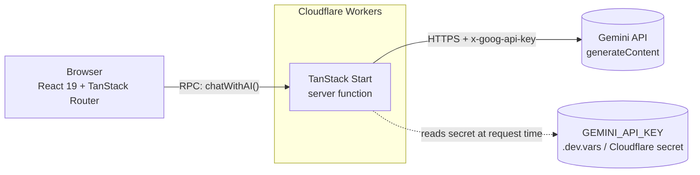
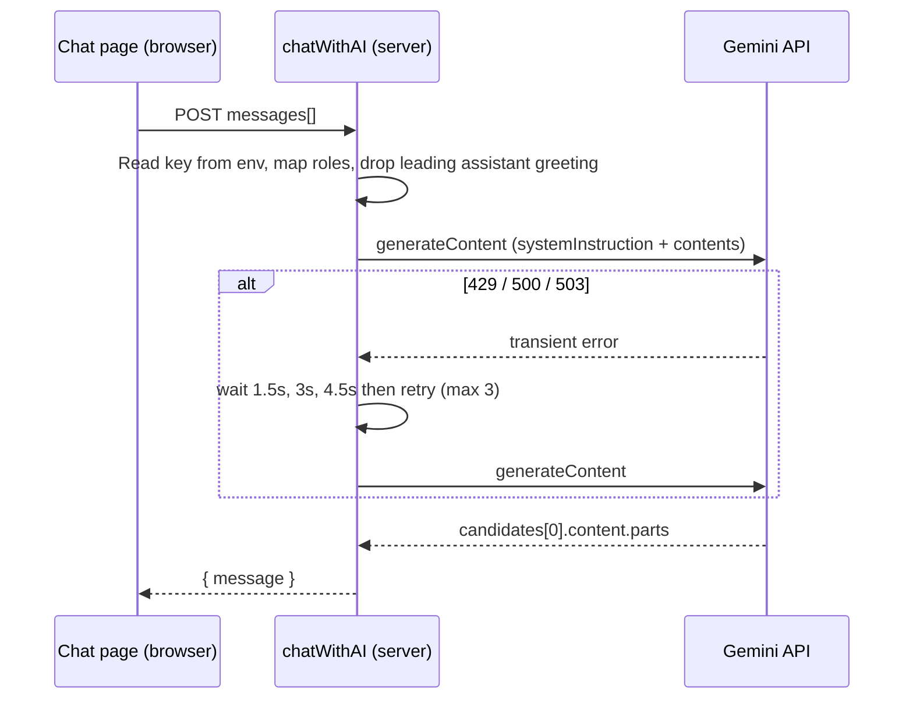

# Mind2Care 💙

**Mind2Care** is a full-stack mental wellness web app: mood tracking, habit-building challenges, curated quotes, a community space, and **Mira**, an AI companion powered by Google Gemini. It is built on a modern type-safe React stack with server functions and deployed to the edge on Cloudflare Workers.

> **Disclaimer:** Mind2Care is a student/portfolio project. Mira is an AI and not a replacement for a therapist, doctor, or crisis service. In a crisis, contact local emergency services or a crisis line (US: call or text **988**, or text HOME to **741741**).

---

## Highlights

- **End-to-end TypeScript** with file-based, type-safe routing (TanStack Router) and RPC-style server functions (TanStack Start). No hand-written REST layer and no separate backend service.
- **Server-side AI integration:** the Gemini API key lives only on the server and is never shipped to the browser bundle.
- **Resilient LLM calls:** automatic retry with backoff on rate limits and transient upstream errors, and clear error surfacing from the provider.
- **Edge deployment:** targets Cloudflare Workers (V8 isolates) with secrets managed outside the codebase.
- **Accessible, animated UI** built on Radix primitives (shadcn/ui), Tailwind CSS 4, Framer Motion, and Recharts.

---

## Features

| Page | Description |
| --- | --- |
| **Dashboard** | Overview of the user's wellness day |
| **AI Chatbot (Mira)** | Supportive conversational companion backed by Gemini |
| **Mood Tracker** | Quick daily mood check-ins |
| **Mood Analytics** | Weekly mood trend and mood distribution charts |
| **Quotes** | Comforting quotes grouped by category |
| **Challenges** | Small wellness challenges for building habits |
| **Mindful Tasks** | Gentle, intentional to-dos |
| **Community** | Anonymous-friendly community space |
| **Growth Journey** | Visual progress over time |
| **Settings** | Personalisation |

**Current scope:** the AI chatbot is fully live. The remaining pages run on sample data from `src/lib/mock-data.ts`, and the auth screens (sign in, sign up, forgot password) are UI only. See [Limitations and next steps](#limitations-and-next-steps).

---

## Architecture



### Chat request lifecycle



---

## Key engineering decisions

### 1. Server functions instead of a hand-rolled API
The chat endpoint is a typed `createServerFn` in `src/lib/chat.functions.ts`. The client calls it like a normal async function; the framework generates the RPC transport. In the client bundle the function body is replaced with a stub, so the Gemini call and the secret never reach the browser. The `*.functions.ts` naming convention is also what TanStack's import protection expects: importing server-only code from a client file under a `server/` directory fails the build, which is how an early version of this project was caught and fixed.

### 2. Secret handling
- The key is read **per request** from `process.env` on the server, never at module load, so Cloudflare secrets work and rotation needs no rebuild.
- It is sent in the `x-goog-api-key` **header** rather than the URL query string, so it does not end up in access logs or proxies.
- Locally it lives in `.dev.vars` (git-ignored); in production it is a Cloudflare secret. `.dev.vars.example` documents the expected variables without containing values.
- Cloudflare's `nodejs_compat` flag (compatibility date `2025-09-24`) exposes bindings and secrets on `process.env`, so the same code path works locally and on Workers.

### 3. Making `.dev.vars` work in `vite dev`
The Cloudflare Vite plugin only runs at **build** time in this setup, so `vite dev` never loaded `.dev.vars`, which was the root cause of the original "API key is missing" error. `vite.config.ts` now parses `.dev.vars` at startup and populates `process.env` (without overriding variables already set), giving local development the same variable contract as production.

### 4. Reliability of the LLM call
- **Retry with linear backoff** (1.5 s, 3 s, 4.5 s; max 3 attempts) on `429`, `500` and `503`, which are the statuses Google returns during demand spikes.
- **Provider error surfacing:** the upstream JSON error message is parsed and propagated, so the UI shows a meaningful reason instead of a generic failure.
- **Defensive response parsing:** empty or malformed candidates produce a clear error instead of a silent blank message.
- **Configurable model** via `GEMINI_MODEL`, so a model deprecation is a config change, not a deploy of new code.

### 5. Conversation mapping for Gemini
Gemini expects roles `user` / `model`, a conversation that starts with a user turn, and the system prompt in a dedicated `systemInstruction` field. The server maps `assistant` to `model`, trims the leading assistant greeting, and passes Mira's persona as a system instruction rather than mixing it into the message history. The server is stateless: each request carries the conversation it needs.

### 6. Routing model
TanStack Router's file-based routes generate a fully typed route tree (`routeTree.gen.ts`). Public routes (`/`, `/signin`, `/signup`, `/forgot-password`) sit beside a pathless **`_app` layout route** that wraps all in-app pages in a shared shell (sidebar, header, animated background), so layout code is written once.

---

## Tech stack

| Layer | Technology |
| --- | --- |
| Framework | TanStack Start (SSR + server functions), React 19 |
| Routing | TanStack Router (file-based, type-safe) |
| Build | Vite 7, `@cloudflare/vite-plugin` |
| Language | TypeScript (strict type-check in CI-style `tsc --noEmit`) |
| Styling | Tailwind CSS 4, shadcn/ui on Radix UI primitives, `class-variance-authority`, `tailwind-merge` |
| Motion and charts | Framer Motion, Recharts |
| AI | Google Gemini via the REST `generateContent` endpoint |
| Runtime and hosting | Cloudflare Workers (`nodejs_compat`) |
| Quality | ESLint (typescript-eslint, react-hooks), Prettier |

---

## Project structure

```
Mind2care/
├── README.md
└── mind2care/
    ├── src/
    │   ├── routes/                 # File-based routes
    │   │   ├── __root.tsx          # Document shell
    │   │   ├── _app.tsx            # Authenticated layout (pathless)
    │   │   ├── _app.chatbot.tsx    # Mira chat UI
    │   │   ├── _app.dashboard.tsx, _app.tracker.tsx, _app.moods.tsx, ...
    │   │   └── index / signin / signup / forgot-password
    │   ├── lib/
    │   │   ├── chat.functions.ts   # Server function: Gemini integration
    │   │   ├── mock-data.ts        # Sample data
    │   │   └── utils.ts
    │   ├── components/             # AppLayout, PageHeader, AuthShell, ui/ (shadcn)
    │   ├── hooks/
    │   ├── router.tsx              # Router + default error boundary
    │   └── routeTree.gen.ts        # Generated route tree
    ├── vite.config.ts              # Also loads .dev.vars for local dev
    ├── wrangler.jsonc              # Cloudflare Workers config
    └── .dev.vars.example           # Environment variable template
```

---

## Configuration

| Variable | Required | Default | Purpose |
| --- | --- | --- | --- |
| `GEMINI_API_KEY` | Yes | none | Gemini API key (server-side only) |
| `GEMINI_MODEL` | No | `gemini-3.8-flash` | Model name; change if Google retires a model |

Local: copy `.dev.vars.example` to `.dev.vars` (git-ignored) and fill in the values, one `NAME=value` per line with no quotes. Restart the dev server after editing. Production: `npx wrangler secret put GEMINI_API_KEY`.

Before committing, verify nothing sensitive is staged:

```bash
git check-ignore -v .dev.vars   # must match a .gitignore rule
git status                      # .dev.vars must not be listed
```

If a key is ever committed, revoke it immediately; deleting it in a later commit does not remove it from history.

---

## Troubleshooting

| Message | Cause and fix |
| --- | --- |
| `GEMINI_API_KEY is missing` | `.dev.vars` not found or malformed, or the dev server was not restarted. On Cloudflare, set the secret. |
| `model ... is no longer available` | Provider retired the model. Set `GEMINI_MODEL` to a current one. |
| `high demand` | Upstream overload. Handled by automatic retries; wait and resend if it persists. |
| `API key not valid` | Wrong or revoked key. Generate a new one. |
| `Failed to fetch` (browser) | Browser cannot reach the dev server. Check it is running and the address matches. |
| `ERESOLVE` on install | Use `npm install --legacy-peer-deps` (peer-dependency conflict between packages). |

---

## Scripts

| Command | Description |
| --- | --- |
| `npm run dev` | Dev server |
| `npm run build` | Production build |
| `npm run preview` | Preview the production build |
| `npm run lint` | ESLint |
| `npm run format` | Prettier |

---

## Limitations and next steps

Being explicit about what is not built yet:

- **Persistence and auth:** moods, tasks and progress are sample data and sign-in is UI only. Next: real authentication and a database (for example Postgres/Supabase or Cloudflare D1) with per-user data.
- **Input validation:** the chat server function trusts its input shape. `zod` is already a dependency and should validate message count, length and roles.
- **Abuse protection:** add per-IP/user rate limiting (Cloudflare rate limiting or Durable Objects) to protect the API quota.
- **Safety layer:** detect crisis language in user messages and surface 988 / crisis resources deterministically, instead of relying only on the model's system prompt.
- **Streaming responses:** switch to Gemini's streaming endpoint for token-by-token replies and better perceived latency.
- **Conversation memory:** persist chat history and trim or summarise long contexts to control token cost.
- **Tests and CI:** unit tests for the Gemini mapping/retry logic and a GitHub Actions workflow running type-check, lint and build.

---

## License

No license has been added yet. Add one (for example MIT) if you want others to reuse the code.
